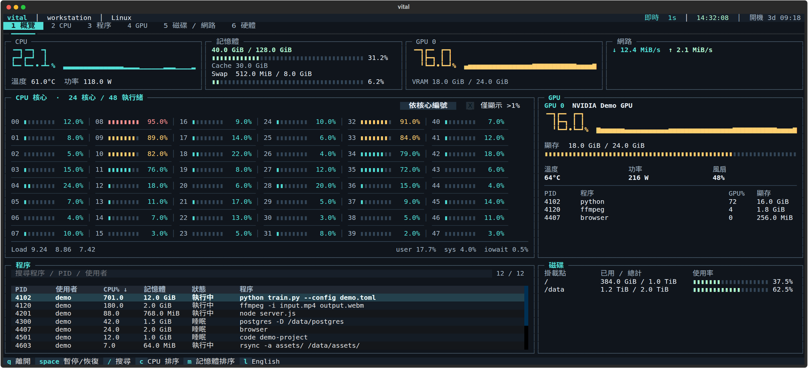
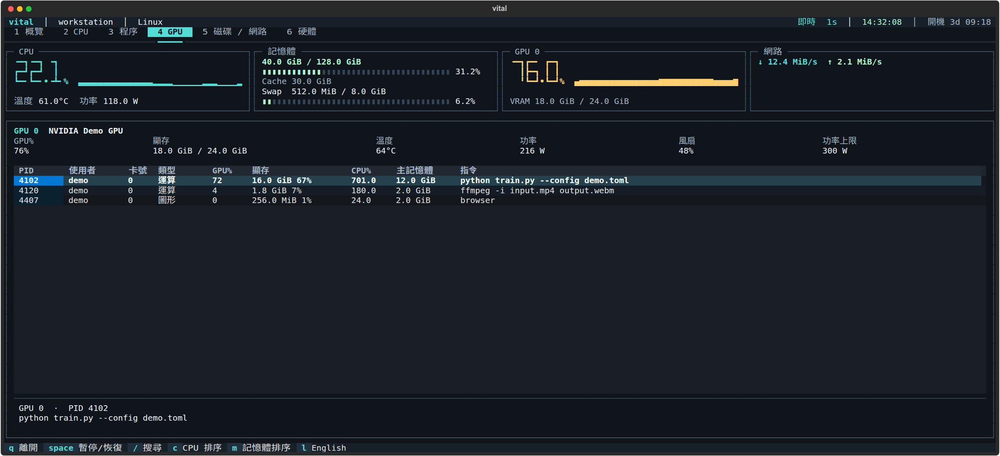
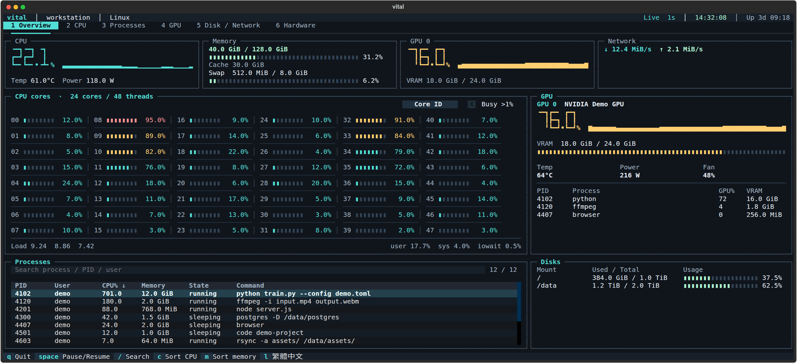
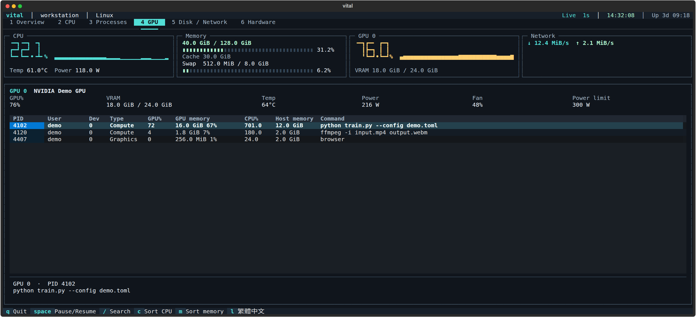

# Vital

Linux 終端機系統監視器，把 `free -h`、`htop`、`nvtop`、`df -h`、`lscpu` 與 `mpstat` 常看的資訊放在同一個介面。適合需要同時追蹤多核心 CPU、NVIDIA GPU 與程序負載的工作環境。

預設每秒更新，提供繁體中文與英文介面，也能輸出文字報表或 JSON 快照。

## 介面



概覽同時顯示逐核心負載、記憶體、GPU、程序與磁碟。文件中的介面圖由實際程式以範例資料擷取。



<details>
<summary>English interface</summary>





</details>

| 分頁 | 內容 |
| --- | --- |
| 概覽 | CPU／記憶體／GPU／網路摘要、逐核心負載、程序搜尋與磁碟容量 |
| CPU | 每個邏輯核心的使用率、user、sys、iowait、idle，以及 Core／Socket／NUMA 拓撲 |
| 程序 | 依 CPU 或記憶體排序，搜尋名稱、完整指令、PID 或使用者 |
| GPU | 各張 NVIDIA GPU 的使用率、顯存、溫度、功率、風扇，以及運算／圖形程序的 GPU%、CPU%、顯存與主記憶體 |
| 磁碟／網路 | 掛載點容量、磁碟讀寫速率與 IOPS、網路介面流量 |
| 硬體 | CPU 型號、快取、系統版本，以及記憶體、Cache 與 Swap 明細 |

寬視窗會把核心負載排列成多欄；窄視窗改成可捲動的直向布局。低於 32 行時收起頂部摘要，記憶體明細仍可在「硬體」頁查看。

## Getting Started

### 環境需求

- Linux（x86_64／aarch64）或 WSL2、Python 3.10 以上，並具備 `venv` 與 `pip`。
- 可顯示 Unicode 的終端機；繁中介面需要中文字型。
- 獨立 NVIDIA GPU 透過驅動程式的 NVML 讀取；Jetson Orin（JetPack 5）直接讀取系統提供的 GPU 負載與溫度。

WSL2 請在 Linux 發行版內安裝與執行；CPU、記憶體與程序數值來自 WSL 環境。NVIDIA GPU 透過 Windows 驅動程式提供的 NVML 讀取。WSL 的 GPU 程序清單可能不完整；逐程序 GPU 使用率顯示 `—`，避免混用 Windows 與 Linux PID。驅動程式未提供的逐程序顯存也顯示 `—`，JSON 為 `null`。參閱 [NVIDIA 的 WSL 支援範圍](https://docs.nvidia.com/cuda/wsl-user-guide/index.html#features-not-yet-supported)。

已在 x86_64 Linux、WSL2，以及 aarch64 的 Orin NX／Orin Nano 實機驗證。這兩台 Jetson 的系統 Python 為 3.8，測試使用獨立的 Python 3.11 環境；安裝 Vital 時仍需 Python 3.10 以上。

Jetson Orin 的 CPU 與 GPU 共用系統 RAM，介面會顯示「共用系統 RAM」。目前的 sysfs 取樣不提供逐程序 GPU 資料、獨立顯存用量或單獨 GPU 功率；缺失數值在 JSON 中為 `null`。GPU 負載與溫度已對照同機的 [tegrastats](https://docs.nvidia.com/jetson/archives/r35.2.1/DeveloperGuide/text/AT/JetsonLinuxDevelopmentTools/TegrastatsUtility.html)。

### 安裝與啟動

```bash
git clone https://github.com/susuky/system_monitor.git
cd system_monitor
python3 -m venv .venv
.venv/bin/python -m pip install -e .
source .venv/bin/activate
vital
```

不啟用虛擬環境時，可在專案目錄執行：

```bash
./vital.sh
```

若習慣使用 `uv`，可用以下兩行取代建立環境與安裝步驟：

```bash
uv venv .venv
uv pip install --python .venv/bin/python -e .
```

### 在任意目錄執行 `vital`

在專案目錄建立帳號專用的指令連結：

```bash
mkdir -p "$HOME/.local/bin"
ln -s "$PWD/.venv/bin/vital" "$HOME/.local/bin/vital"
export PATH="$HOME/.local/bin:$PATH"
```

將最後一行放進 shell 啟動設定（例如 Bash 的 `~/.bashrc`），新終端機也能直接使用 `vital`。一般監看不需要 root 權限。

### 語言

```bash
vital --lang en
vital --lang zh-TW
```

預設為繁體中文。也可在介面按 `l` 切換；兩種方式都會保存選擇。設定位於 `~/.config/vital/config.json`，或 `$XDG_CONFIG_HOME/vital/config.json`。命令說明與文字報表會跟著切換。從舊版升級時會沿用 `~/.config/sysmon/config.json` 的語言選擇；舊的 `sysmon` 指令與 `./sysmon.sh` 仍可使用。

## 操作

| 按鍵 | 功能 |
| --- | --- |
| `1`～`6` | 切換分頁 |
| `Space` | 暫停／恢復畫面更新 |
| `/` | 搜尋程序 |
| `Esc` | 清除搜尋並回到表格 |
| `c`／`m` | 程序依 CPU／記憶體排序 |
| `b` | 核心依編號／使用率排序 |
| `l` | 切換英文／繁中並保存 |
| 方向鍵 | 移動表格選取位置 |
| `Ctrl+C`／`q` | 離開；`Ctrl+C` 在搜尋框也會直接離開 |

概覽與 CPU 頁面可勾選「>1%」篩選忙碌核心。程序總覽顯示前 100 筆；「程序」頁可查看全部符合條件的程序，以及選取項目的完整指令。GPU 頁顯示各個運算與圖形程序，方向鍵可選取並查看完整指令；窄視窗可橫向捲動表格。

## 取樣與匯出

```bash
vital --interval 0.5
vital --once
vital --interval 1 --samples 5
vital --json
vital --json -i 1 -n 5 > samples.ndjson
vital --help
```

`--once` 輸出一次資源摘要。`--samples` 會加上每個核心的 user、system、iowait、idle 與忙碌百分比，可對應 `mpstat 1 5` 的連續觀察方式。啟動後會先等待一個取樣間隔，以取得 CPU 用率與傳輸速率；最短間隔為 0.2 秒。

`--json` 輸出完整快照，搭配 `--samples` 時每行一筆。JSON 欄位不受介面語言影響。快照包含主機名稱、程序指令、使用者與網路位址，分享前請先移除敏感內容。

## 數值與感測器

- 容量使用 KiB、MiB、GiB 等二進位單位；記憶體使用量為總量減可用量。
- Cache 包含可回收的核心快取（SReclaimable），Buffers 另列。
- 程序 CPU 使用率以單一邏輯核心為 100%，多執行緒程序可超過 100%；整體 CPU 與各核心的忙碌百分比不含 idle、iowait。
- CPU 溫度依硬體感測器提供；CPU 功率取自 Linux RAPL 封裝能耗差值。
- GPU 程序的 GPU% 來自 NVML 最近的 SM 使用率樣本；沒有近期樣本或硬體不支援時顯示 `—`。顯存百分比為該程序占整張卡顯存總量的比例，主記憶體為 RSS。
- 感測器不存在或讀取權限不足時顯示 `—`，JSON 為 `null`。CPU 頁會顯示功率讀取狀態。

## 開發與驗證

```bash
.venv/bin/python -m unittest discover -s tests -v
```

測試涵蓋本機取樣、程序 CPU 負載、核心缺號與熱插拔、RAPL 計數器回繞，以及介面的搜尋、排序、暫停、語言保存和視窗縮放。

量測監視器自身開銷：

```bash
.venv/bin/python scripts/benchmark.py
```

此腳本先量測資料採集，再於 160 × 44 的真實 PTY 中，以預設每秒更新分別執行概覽與程序頁 30 秒；CPU 百分比以單一邏輯核心為 100%。輸出同時包含程序數與記憶體使用量，方便比較不同主機與版本。

2026-11-10 在 Linux PC、兩台 Orin 與 WSL2 比較本輪優化前後。兩版都每秒更新、使用 160 × 44 終端機；每頁先暖機，再分別量測舊版 20 秒、新版 30 秒，WSL2 則兩版各 20 秒。CPU 以單一邏輯核心為 100%，下表為「修改前 → 修改後」。

| 主機 | 程序數（前／後） | 概覽 CPU | 程序頁 CPU | 新版 RSS |
| --- | ---: | ---: | ---: | ---: |
| Linux PC，48 執行緒 | 1,245／1,249 | 9.55% → 7.00% | 11.70% → 6.87% | 73.1–79.8 MiB |
| Orin NX，8 核心 | 313／311 | 11.00% → 6.03% | 10.65% → 5.47% | 49.1–50.6 MiB |
| Orin Nano，6 核心 | 300／300 | 18.55% → 9.77% | 17.70% → 8.60% | 48.7–50.3 MiB |
| WSL2 PC，32 執行緒 | 67／67 | 4.10% → 1.95% | 3.15% → 1.45% | 76.3–76.7 MiB |

每次採集的 CPU 時間分別從 61.99 → 51.18 ms、28.31 → 21.52 ms、44.15 → 34.73 ms、5.36 → 4.28 ms。程序資源數值、使用者與指令仍每秒重讀；只重用未變的顯示內容，減少表格繪製、整體重排與無用的感測器讀取。概覽按排名更新既有列，程序頁保留 PID 選取。

這些主機仍有可量到的監控成本。程序數、核心數、GPU 驅動、終端機尺寸與硬體速度會影響結果；原版 Jetson Nano 尚未實測。

若要定位 CPU 花在哪裡，可在真實 PTY 分別量測 UI 與採集執行緒：

```bash
.venv/bin/python scripts/profile_runtime.py --output artifacts/profile-ui --profile ui
.venv/bin/python scripts/profile_runtime.py --output artifacts/profile-collector --profile collector
```

Profiler 會增加開銷，適合找瓶頸；對外比較 CPU 用量請使用未開 profiler 的 `benchmark.py`。Python 3.12 的 profiler 可能包含其他執行緒，腳本另以執行緒 CPU 時鐘記錄各部分時間。

介面圖的範例資料與擷取腳本位於 [scripts/capture_demo.py](scripts/capture_demo.py)，執行後產生兩種語言的 SVG：

```bash
.venv/bin/python scripts/capture_demo.py
```

## Copyright

Third-party dependencies retain their respective licenses.

```text
Copyright © 2026 Hao-Ping Lin (@susuky). All rights reserved.

This repository is publicly accessible for viewing and evaluation only.
No license is granted to use, copy, modify, redistribute, sublicense,
or use this software commercially without prior written permission
from the copyright holder.
```

完整聲明見 [LICENSE](LICENSE)。
