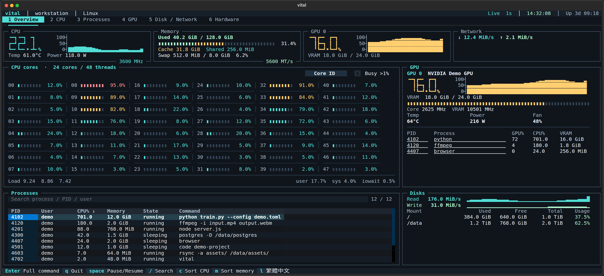
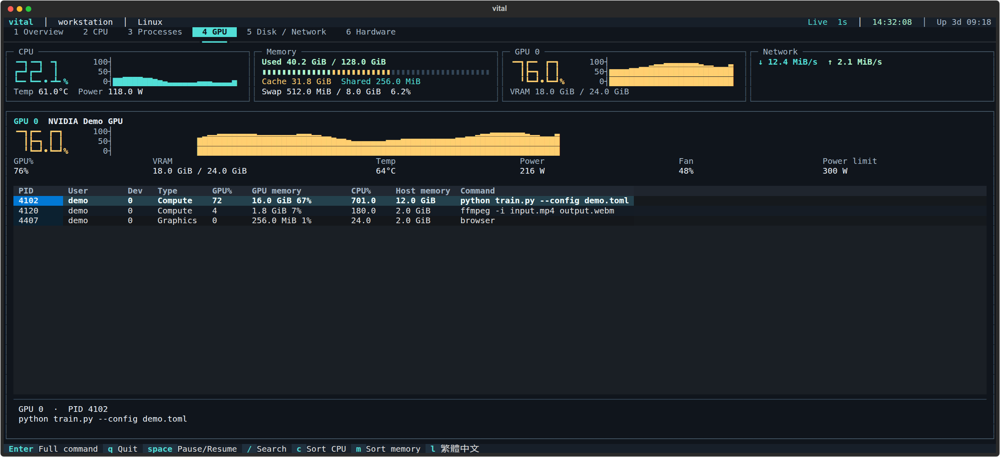
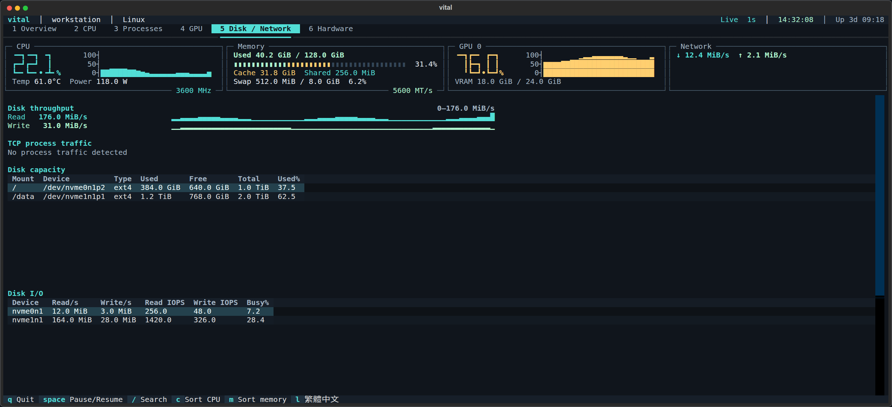
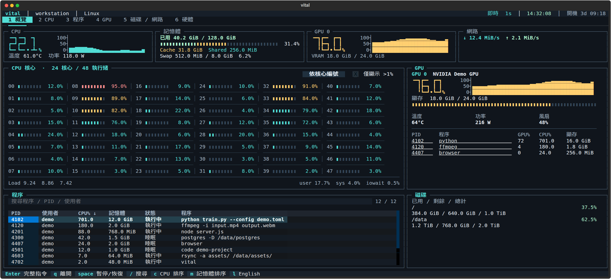
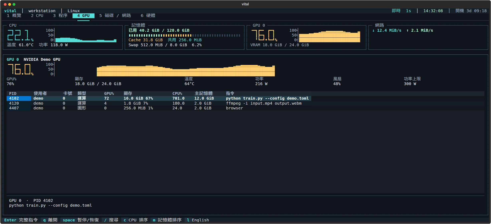
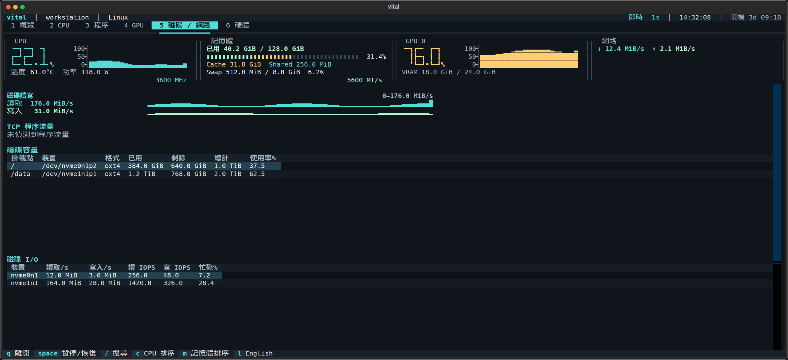

# Vital

**English** | [繁體中文](README.zh-TW.md)

A terminal system monitor for CPU, NVIDIA GPU, memory, processes, disks, and network traffic on Linux and Windows. It refreshes every second by default, supports English and Traditional Chinese, and exports text or JSON.

## Interface



Screenshots use sample data.





<details>
<summary>Traditional Chinese interface</summary>







</details>

| Tab | Contents |
| --- | --- |
| Overview | CPU, memory, GPU, and network summaries, top network processes, per-core load, process search, and disk capacity with live read and write trends |
| CPU | CPU clock and per-core usage, user, sys, iowait, and idle time, plus core, socket, and NUMA topology |
| Processes | Sort by CPU or memory; search by name, full command, PID, or user |
| GPU | Core and VRAM clocks, usage, VRAM, temperature, power, and fan speed for each NVIDIA GPU, plus per-process GPU%, CPU%, VRAM, and RAM |
| Disk / Network | Disk read and write charts, per-device I/O and IOPS, filesystem capacity, and network traffic by process and interface |
| Hardware | CPU model, CPU caches, OS version, RAM transfer rate, memory usage, cache, and swap |

Wide terminals display core load in multiple columns. Narrow terminals use a scrollable vertical layout. The top summaries are hidden below 32 rows; memory details remain available in the Hardware tab.

Click a network process in the overview to see its command. Press `5` for the receive and send rates of each process, ranked by combined rate. Click a row or press Enter to open its full command.

Run `sudo .venv/bin/vital` on Linux or WSL2 to measure TCP and UDP. A standard launch reads TCP socket counters. On Windows, run Vital as administrator to measure TCP and UDP.

## Getting Started

### Requirements

- Linux (x86_64 or aarch64), WSL2, or native Windows (PowerShell 5.1 or 7). Source installs and Windows builds need Python 3.10 or later, `venv`, and `pip`; the standalone Windows executable runs without Python installed.
- A terminal with Unicode support. The Traditional Chinese interface also needs a Chinese font.
- Discrete NVIDIA GPUs are read through the driver's NVML library. Jetson Orin (JetPack 5) uses GPU load, core clock, and temperature readings exposed by the system.

On WSL2, install and run Vital inside your Linux distribution. CPU, memory, and process values describe the WSL environment. NVIDIA GPU data comes from NVML provided by the Windows driver. The GPU process list may be incomplete, and per-process GPU usage is shown as `—` to avoid mixing Windows and Linux PIDs. Per-process VRAM is also shown as `—` when the driver does not provide it, or `null` in JSON. See [NVIDIA's WSL support limitations](https://docs.nvidia.com/cuda/wsl-user-guide/index.html#features-not-yet-supported).

Jetson Orin's CPU and GPU share system RAM, so Vital displays `Shared system RAM`. The current sysfs source does not provide per-process GPU data, dedicated VRAM usage, or separate GPU power readings. Missing values are `null` in JSON.

On Windows, Vital reads CPU topology and cache sizes, disk active time, and Intel CPU package power where Windows exposes a RAPL Energy Meter. The CPU tab shows DPC time, stored as `softirq` in JSON. Linux load average and iowait are `null` in Windows snapshots.

Windows CPU utilization support covers a single processor group, typically up to 64 logical processors. [psutil processor group issue](https://github.com/giampaolo/psutil/issues/2972)

Windows NVIDIA GPU readings use the driver's NVML library. On WDDM, Vital reads per-process dedicated memory from Windows and matches it to the NVIDIA adapter. Per-process GPU usage depends on the driver.

### Install on Linux or WSL2

```bash
git clone https://github.com/susuky/system_monitor.git
cd system_monitor
python3 -m venv .venv
.venv/bin/python -m pip install -e .
source .venv/bin/activate
vital --lang en
```

From the project directory, `./vital.sh` also runs Vital without activating the virtual environment.

### Install on Windows

From the project directory in PowerShell, run these commands with Python 3.10 or later.

```powershell
python -m venv .venv-windows
.\.venv-windows\Scripts\python.exe -m pip install -e .
.\.venv-windows\Scripts\vital.exe
```

To build a standalone executable with the Vital icon, install PyInstaller once, then run the build script. `-InstallDesktop` updates the copy on your Windows desktop:

```powershell
.\.venv-windows\Scripts\python.exe -m pip install "pyinstaller>=6,<7"
powershell -ExecutionPolicy Bypass -File .\scripts\build_windows.ps1 -InstallDesktop
```

The build creates `dist\vital.exe` and copies it to your desktop. Double-click that file to launch Vital. You can also place the standalone executable in a folder on your user `Path` to run `vital` from any directory. To use another Python environment for the build, pass `-Python "C:\path\to\python.exe"`.

When PowerShell allows local scripts, `.\vital.ps1` also launches Vital and forwards its arguments:

```powershell
.\vital.ps1 --json | ConvertFrom-Json
```

### CPU temperature on Windows

HWiNFO is optional and supplies the live CPU package temperature on Windows. Run HWiNFO in **Sensors-only** mode. In **Configure Sensors → HWiNFO Gadget**, enable **Enable reporting to Gadget**. Select **CPU Package** under the Intel CPU's DTS group or **CPU (Tctl/Tdie)** on AMD, then check **Report value in Gadget** for that sensor. [HWiNFO Gadget setup](https://docs.rainmeter.net/tips/hwinfo/)

### Run `vital` from Any Directory on Linux or WSL2

From the project directory, create a command link for your account:

```bash
mkdir -p "$HOME/.local/bin"
ln -s "$PWD/.venv/bin/vital" "$HOME/.local/bin/vital"
export PATH="$HOME/.local/bin:$PATH"
```

Add the last line to your shell's startup file, such as `~/.bashrc` for Bash, to make `vital` available in new terminals. Normal monitoring does not require root privileges.

To read restricted CPU power counters, run from the project directory:

```bash
sudo .venv/bin/vital
```

### Language

```bash
vital --lang en
vital --lang zh-TW
```

The default language is Traditional Chinese. Press `l` to switch languages in the interface. The choice also applies to help and text reports and is saved in `~/.config/vital/config.json`, or `$XDG_CONFIG_HOME/vital/config.json`.

## Controls

| Key | Action |
| --- | --- |
| `1`–`6` | Switch tabs |
| `Space` | Pause or resume display updates |
| `/` | Search processes |
| `Esc` | Close the full-command window, or clear the search and return to the table |
| `c` / `m` | Sort processes by CPU / memory |
| `b` | Sort cores by ID or usage |
| `l` | Switch between English and Traditional Chinese and save the choice |
| `↑` / `↓` | Select a process |
| `←` / `→` | Scroll the table horizontally; the PID stays visible |
| `Home` / `End` | Jump to the beginning / end of the table's columns |
| `Enter` | Open the selected process's full command |
| `Ctrl+C` | Copy selected text in the full-command window; quit elsewhere |
| `q` | Quit from the main screen |

Use the `>1%` checkbox in Overview or CPU to show only busy cores. Overview lists the top 100 processes. The Processes tab lists all matching processes, and the GPU tab lists compute and graphics processes.

The full-command window wraps long commands. Drag to select text and use arrow keys, `PageUp` / `PageDown`, or `Home` / `End` to scroll. Right-click a blank area to close it. Clicking a PID or process name in Overview's GPU panel also opens its full command.

## Sampling and Export

```bash
vital --interval 0.5
vital --text
vital --interval 1 --samples 5
vital --json
vital --json -i 1 -n 5 > samples.ndjson
vital --help
```

`--text` (also `--once`) prints one resource summary without opening the interactive interface. `--samples` includes per-core user, system, iowait, idle, and busy percentages, similar to `mpstat 1 5`. Vital waits one sampling interval at startup to calculate CPU usage and transfer rates. The minimum interval is 0.2 seconds.

`--json` exports a complete snapshot for scripts and agents. With `--samples`, it writes one JSON object per line (NDJSON), flushing each sample as it arrives. Sampling supports redirected input and output; JSON runs without loading the terminal UI. JSON field names are independent of the interface language.

To view several GPUs using software-generated readings:

```bash
vital --demo-gpus 4
vital --json --demo-gpus 4 -i 1 -n 3
```

`--demo-gpus COUNT` replaces GPU readings with the specified positive number of simulated GPUs. GPU names and status identify the simulation, and each GPU has `simulated: true` in JSON. CPU, memory, disks, network, and host processes continue to show real readings. Omit the option to read hardware GPUs.

## Metrics and Sensors

- Sizes use binary units: KiB, MiB, and GiB. Disks list used, free, and total space, in that order.
- The memory bar separates ordinary used RAM, shared RAM, cache, and free RAM. The used total above it includes shared RAM. Cache combines buffers and reclaimable kernel cache (`SReclaimable`), with shared RAM deducted so the segments add up to total RAM.
- Available RAM is the operating system's estimate of memory usable by new processes, shown separately. Text output, the Hardware tab, and JSON retain raw fields: used is `total - available`, raw cache includes shared RAM, and buffers are separate. These raw categories differ from the bar's segments. Unsupported memory fields on Windows appear as `—`, or `null` in JSON.
- CPU and per-GPU history charts use a fixed 0–100% scale, showing up to 90 consecutive samples. Each GPU has its own history; scroll the GPU panel or GPU tab to see every card.
- CPU, GPU core, and VRAM clocks use MHz. RAM transfer rates use MT/s. An unavailable RAM rate appears as `—`, with an empty `memory.speeds_mts` array in JSON.
- Disk read and write charts show total throughput across devices. The two traces share a scale based on the peak in the visible samples. Vital keeps up to 90 samples.
- Process CPU usage treats one logical core as 100%, so multithreaded processes can exceed 100%. Overall and per-core busy percentages exclude idle and iowait.
- On Linux, CPU temperature comes from hardware sensors. CPU power comes from changes in RAPL package energy counters.
- Per-process GPU% comes from recent NVML SM utilization samples. It is shown as `—` when no recent sample is available or the hardware does not support it. VRAM percentage is the process's share of the GPU's total VRAM; process RAM is RSS.
- Unavailable sensors and permission-restricted readings appear as `—`, or `null` in JSON. The CPU tab shows the status of power readings.

## Profiling on Linux and WSL2

These measurements use `benchmark.py` without a profiler, with one logical core equal to 100% CPU. All platforms used a real PTY, a one-second refresh interval, and a 160 × 44 terminal. Each tab had a five-second warmup, followed by 30 seconds of measurement on Linux PC and Orin, or 20 seconds on WSL2.

| Platform | Processes | Overview CPU | Processes tab CPU | RSS |
| --- | ---: | ---: | ---: | ---: |
| Linux PC, 48 threads | 1,249 | 7.00% | 6.87% | 73.1–79.8 MiB |
| Orin NX, 8 cores | 311 | 6.03% | 5.47% | 49.1–50.6 MiB |
| Orin Nano, 6 cores | 300 | 9.77% | 8.60% | 48.7–50.3 MiB |
| WSL2 PC, 32 threads | 67 | 1.95% | 1.45% | 76.3–76.7 MiB |

Overhead varies with process count, core count, GPU driver, terminal size, and hardware speed. To measure it on your system:

```bash
.venv/bin/python scripts/benchmark.py
```

The script measures each tab for 30 seconds by default; use `--seconds 20` to change the duration. Its output includes collector CPU time, process count, TUI CPU usage, and RSS.

To locate CPU bottlenecks, profile the UI and collector threads separately in a real PTY:

```bash
.venv/bin/python scripts/profile_runtime.py --output artifacts/profile-ui --profile ui
.venv/bin/python scripts/profile_runtime.py --output artifacts/profile-collector --profile collector
```

## Copyright

Third-party dependencies retain their respective licenses.

```text
Copyright © 2026 Hao-Ping Lin (@susuky). All rights reserved.

This repository is publicly accessible for viewing and evaluation only.
No license is granted to use, copy, modify, redistribute, sublicense,
or use this software commercially without prior written permission
from the copyright holder.
```

See [LICENSE](LICENSE) for the full notice.
