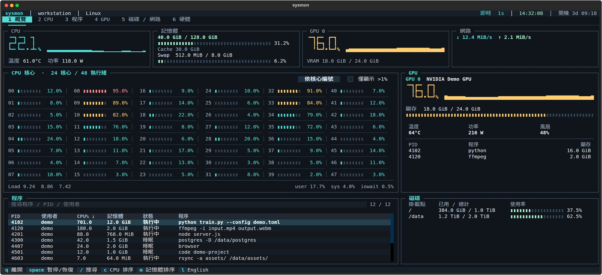
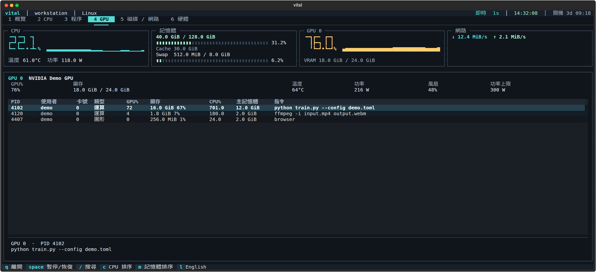
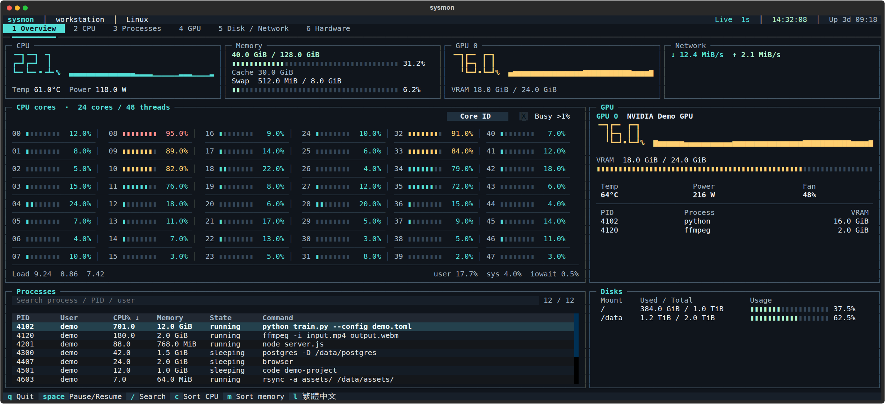
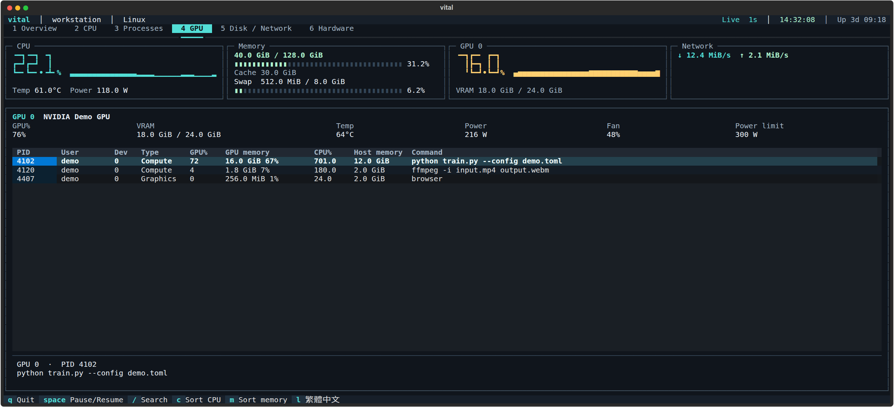

# Vital

[English](README.md) | **繁體中文**

Vital 是 Linux 和 Windows 的終端機系統監視器，同時顯示 CPU、NVIDIA GPU、記憶體、程序、磁碟與網路流量。

預設每秒更新，提供繁體中文與英文介面，也能輸出文字報表或 JSON 快照。

## 介面



概覽同時顯示逐核心負載、記憶體、GPU、程序與磁碟。文件中的介面圖由實際程式以範例資料擷取。



<details>
<summary>English interface</summary>





</details>

| 分頁 | 內容 |
| --- | --- |
| 概覽 | CPU／記憶體／GPU／網路摘要、逐核心負載、程序搜尋與磁碟容量 |
| CPU | 每個邏輯核心的使用率、user、sys、iowait、idle，以及 Core／Socket／NUMA 拓撲 |
| 程序 | 依 CPU 或記憶體排序，搜尋名稱、完整指令、PID 或使用者 |
| GPU | 各張 NVIDIA GPU 的使用率、顯存、溫度、功率、風扇，以及運算／圖形程序的 GPU%、CPU%、顯存與主記憶體 |
| 磁碟／網路 | 掛載點容量、磁碟讀寫速率與 IOPS、網路介面流量 |
| 硬體 | CPU 型號、快取、系統版本，以及記憶體、Cache 與 Swap 明細 |

寬視窗會把核心負載排列成多欄；窄視窗改成可捲動的直向布局。低於 32 行時收起頂部摘要，記憶體明細仍可在「硬體」頁查看。

## 安裝與使用

### 環境需求

- Linux（x86_64／aarch64）、WSL2 或原生 Windows（PowerShell 5.1 或 7）。需要 Python 3.10 以上及 `venv`、`pip`。
- 可顯示 Unicode 的終端機；繁中介面需要中文字型。
- 獨立 NVIDIA GPU 透過驅動程式的 NVML 讀取；Jetson Orin（JetPack 5）直接讀取系統提供的 GPU 負載與溫度。

WSL2 請在 Linux 發行版內安裝與執行；CPU、記憶體與程序數值來自 WSL 環境。NVIDIA GPU 透過 Windows 驅動程式提供的 NVML 讀取。WSL 的 GPU 程序清單可能不完整；逐程序 GPU 使用率顯示 `—`，避免混用 Windows 與 Linux PID。驅動程式未提供的逐程序顯存也顯示 `—`，JSON 為 `null`。參閱 [NVIDIA 的 WSL 支援範圍](https://docs.nvidia.com/cuda/wsl-user-guide/index.html#features-not-yet-supported)。

Jetson Orin 的 CPU 與 GPU 共用系統 RAM，介面會顯示「共用系統 RAM」。目前的 sysfs 取樣不提供逐程序 GPU 資料、獨立顯存用量或單獨 GPU 功率；缺失數值在 JSON 中為 `null`。

Windows 版會顯示 CPU 拓撲、快取容量及磁碟忙碌率。Windows 有提供 RAPL Energy Meter 時，也會顯示 Intel CPU 封裝功耗。CPU 頁的 DPC 時間對應 JSON 的 `softirq` 欄位。Windows 快照的 `load` 和 `iowait` 為 `null`。

Windows 的 CPU 使用率支援單一處理器群組，通常最多 64 個邏輯處理器。[psutil 處理器群組問題](https://github.com/giampaolo/psutil/issues/2972)

NVIDIA GPU 數值來自 Windows 驅動程式的 NVML。WDDM 模式下，Vital 從 Windows 讀取逐程序專用顯存並對應到 NVIDIA 顯示卡。逐程序 GPU 使用率取決於驅動程式。

### 在 Linux 或 WSL2 安裝

```bash
git clone https://github.com/susuky/system_monitor.git
cd system_monitor
python3 -m venv .venv
.venv/bin/python -m pip install -e .
source .venv/bin/activate
vital
```

不啟用虛擬環境時，可在專案目錄執行：

```bash
./vital.sh
```

若習慣使用 `uv`，可用以下兩行取代建立環境與安裝步驟：

```bash
uv venv .venv
uv pip install --python .venv/bin/python -e .
```

### 在 Windows 安裝

在專案目錄開啟 PowerShell，使用 Python 3.10 以上執行以下指令。

```powershell
python -m venv .venv-windows
.\.venv-windows\Scripts\python.exe -m pip install -e .
.\.venv-windows\Scripts\vital.exe
```

若要在 PowerShell 的任意目錄執行 `vital`，把 `vital.exe` 複製到使用者 `Path` 裡的資料夾。也可以建立指向該執行檔的桌面捷徑。專案與虛擬環境需留在安裝時的位置。

PowerShell 執行原則允許本機指令碼時，也可以用 `.\vital.ps1` 啟動或將快照傳給 PowerShell。

```powershell
.\vital.ps1
.\vital.ps1 --once
.\vital.ps1 --json | ConvertFrom-Json
```

### Windows CPU 溫度

HWiNFO 是選用元件，提供 Windows 的即時 CPU 封裝溫度。用 **Sensors-only** 模式開啟 HWiNFO，在 **Configure Sensors → HWiNFO Gadget** 勾選 **Enable reporting to Gadget**。Intel 選 CPU 的 DTS 群組下的 **CPU Package（CPU封裝）**，AMD 選 **CPU (Tctl/Tdie)**，再勾選該感測器的 **Report value in Gadget**。[HWiNFO Gadget 設定圖解](https://docs.rainmeter.net/tips/hwinfo/)

若要在登入後於背景取樣，在 HWiNFO 主設定勾選 **Auto Start**、**Minimize Main Window on Startup** 和 **Minimize Sensors on Startup**，取消 **Show Welcome Screen and Progress**。登入後可執行 `vital --once` 確認 CPU 溫度。[HWiNFO 啟動設定](https://www.hwinfo.com/forum/threads/auto-logging-to-a-specific-drive-and-csv.10469/)

### 在 Linux 或 WSL2 的任意目錄執行 `vital`

在專案目錄建立帳號專用的指令連結：

```bash
mkdir -p "$HOME/.local/bin"
ln -s "$PWD/.venv/bin/vital" "$HOME/.local/bin/vital"
export PATH="$HOME/.local/bin:$PATH"
```

將最後一行放進 shell 啟動設定（例如 Bash 的 `~/.bashrc`），新終端機也能直接使用 `vital`。一般監看不需要 root 權限。

若要用 `sudo vital` 讀取受限的 CPU 功耗計數器，建立一次系統指令連結：

```bash
sudo ln -s "$HOME/.local/bin/vital" /usr/local/bin/vital
sudo vital
```

### 語言

```bash
vital --lang en
vital --lang zh-TW
```

預設為繁體中文。也可在介面按 `l` 切換；兩種方式都會保存選擇。設定位於 `~/.config/vital/config.json`，或 `$XDG_CONFIG_HOME/vital/config.json`。命令說明與文字報表會跟著切換。從舊版升級時會沿用 `~/.config/sysmon/config.json` 的語言選擇；舊的 `sysmon` 指令與 `./sysmon.sh` 仍可使用。

## 操作

| 按鍵 | 功能 |
| --- | --- |
| `1`～`6` | 切換分頁 |
| `Space` | 暫停／恢復畫面更新 |
| `/` | 搜尋程序 |
| `Esc` | 清除搜尋並回到表格 |
| `c`／`m` | 程序依 CPU／記憶體排序 |
| `b` | 核心依編號／使用率排序 |
| `l` | 切換英文／繁中並保存 |
| 方向鍵 | 移動表格選取位置 |
| `Ctrl+C`／`q` | 離開；`Ctrl+C` 在搜尋框也會直接離開 |

概覽與 CPU 頁面可勾選「>1%」篩選忙碌核心。程序總覽顯示前 100 筆；「程序」頁可查看全部符合條件的程序，以及選取項目的完整指令。GPU 頁顯示各個運算與圖形程序，方向鍵可選取並查看完整指令；窄視窗可橫向捲動表格。

## 取樣與匯出

```bash
vital --interval 0.5
vital --once
vital --interval 1 --samples 5
vital --json
vital --json -i 1 -n 5 > samples.ndjson
vital --help
```

`--once` 輸出一次資源摘要。`--samples` 會加上每個核心的 user、system、iowait、idle 與忙碌百分比，可對應 `mpstat 1 5` 的連續觀察方式。啟動後會先等待一個取樣間隔，以取得 CPU 用率與傳輸速率；最短間隔為 0.2 秒。

`--json` 輸出完整快照，搭配 `--samples` 時每行一筆。JSON 欄位不受介面語言影響。快照包含主機名稱、程序指令、使用者與網路位址，分享前請先移除敏感內容。

## 數值與感測器

- 容量使用 KiB、MiB、GiB 等二進位單位；記憶體使用量為總量減可用量。
- Linux 的 Cache 包含可回收的核心快取（SReclaimable），Buffers 另列。
- 程序 CPU 使用率以單一邏輯核心為 100%，多執行緒程序可超過 100%；整體 CPU 與各核心的忙碌百分比不含 idle、iowait。
- Linux 的 CPU 溫度來自硬體感測器，CPU 功率由 RAPL 封裝能耗差值算出。
- GPU 程序的 GPU% 來自 NVML 最近的 SM 使用率樣本；沒有近期樣本或硬體不支援時顯示 `—`。顯存百分比為該程序占整張卡顯存總量的比例，主記憶體為 RSS。
- 感測器不存在或讀取權限不足時顯示 `—`，JSON 為 `null`。CPU 頁會顯示功率讀取狀態。

## Linux 與 WSL2 效能量測

以下為 Vital 自身的資源用量，CPU 以單一邏輯核心為 100%。各平台皆使用真實 PTY、每秒更新與 160 × 44 終端機；每頁暖機 5 秒，Linux PC 與 Orin 量測 30 秒，WSL2 量測 20 秒。

| 平台 | 程序數 | 概覽 CPU | 程序頁 CPU | RSS |
| --- | ---: | ---: | ---: | ---: |
| Linux PC，48 執行緒 | 1,249 | 7.00% | 6.87% | 73.1–79.8 MiB |
| Orin NX，8 核心 | 311 | 6.03% | 5.47% | 49.1–50.6 MiB |
| Orin Nano，6 核心 | 300 | 9.77% | 8.60% | 48.7–50.3 MiB |
| WSL2 PC，32 執行緒 | 67 | 1.95% | 1.45% | 76.3–76.7 MiB |

程序數、核心數、GPU 驅動、終端機尺寸與硬體速度會影響開銷。可在自己的環境執行相同量測：

```bash
.venv/bin/python scripts/benchmark.py
```

腳本預設量測每頁 30 秒，可用 `--seconds 20` 調整；輸出包含資料採集的 CPU 時間、程序數、介面 CPU 用量與 RSS。

若要定位 CPU 花在哪裡，可在真實 PTY 分別量測 UI 與採集執行緒：

```bash
.venv/bin/python scripts/profile_runtime.py --output artifacts/profile-ui --profile ui
.venv/bin/python scripts/profile_runtime.py --output artifacts/profile-collector --profile collector
```

上表使用未開 profiler 的 `benchmark.py`。Profiler 會增加開銷，適合定位瓶頸；Python 3.12 的 profiler 可能包含其他執行緒，腳本另以執行緒 CPU 時鐘記錄各部分時間。

## Copyright

Third-party dependencies retain their respective licenses.

```text
Copyright © 2026 Hao-Ping Lin (@susuky). All rights reserved.

This repository is publicly accessible for viewing and evaluation only.
No license is granted to use, copy, modify, redistribute, sublicense,
or use this software commercially without prior written permission
from the copyright holder.
```

完整聲明見 [LICENSE](LICENSE)。
